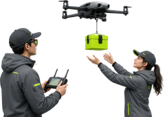
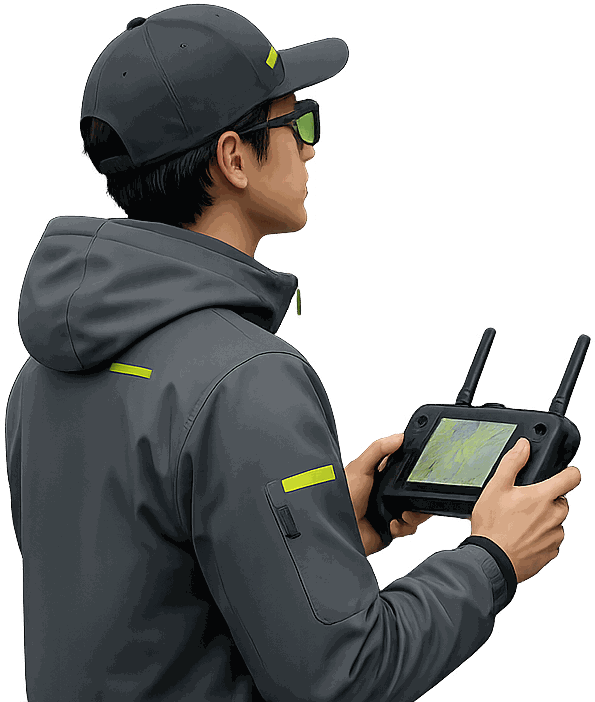
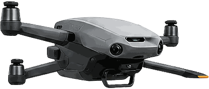

Before sign-in there is nothing of the user's to show, so the desktop is the map, the logo, the theme and one window: what DRON is, then how to get in.

## Composition

```html
<div class="dr dr-screen dr-desk" style="width:1440px;height:900px;max-width:none">
  <div class="dr-mapground" role="img" aria-label="Live map of Kyiv, 128 drones in the air"><span class="dr-mapground__drone" style="left:31%;top:34%"></span><span class="dr-mapground__drone" style="left:44%;top:58%"></span><span class="dr-mapground__drone" style="left:63%;top:30%"></span><span class="dr-mapground__drone" style="left:70%;top:66%"></span><span class="dr-mapground__drone" style="left:60%;top:82%"></span><span class="dr-mapground__drone" style="left:38%;top:76%"></span><span class="dr-mapground__drone" style="left:78%;top:44%"></span><span class="dr-mapground__drone" style="left:24%;top:60%"></span><span class="dr-mapground__drone" style="left:58%;top:48%"></span></div>
  <div class="dr-veil" aria-hidden="true"></div>
  <header class="dr-whead">
    <a class="dr-brandlink" href="../../research.html" aria-label="DRON project"><span class="dr-brand" aria-hidden="true"></span></a>
    <div class="dr-whead__end">
      <button class="dr-iconbtn dr-material" type="button" data-theme-cycle aria-label="Switch the theme"><svg class="dr-ic dr-iconbtn__moon" viewBox="0 0 24 24" fill="none" stroke="currentColor" stroke-width="1.7" stroke-linecap="round" stroke-linejoin="round" aria-hidden="true"><path d="M19.5 14.5A8 8 0 0 1 9.5 4.5a8 8 0 1 0 10 10z"/></svg><svg class="dr-ic dr-iconbtn__sun" viewBox="0 0 24 24" fill="none" stroke="currentColor" stroke-width="1.7" stroke-linecap="round" stroke-linejoin="round" aria-hidden="true"><circle cx="12" cy="12" r="4"/><path d="M12 3v2M12 19v2M3 12h2M19 12h2M5.6 5.6l1.4 1.4M17 17l1.4 1.4M5.6 18.4L7 17M17 7l1.4-1.4"/></svg></button>
    </div>
  </header>
  <div class="dr-dim" aria-hidden="true"></div>
  <main class="dr-window dr-material dr-entry dr-entry--flush" aria-label="Sign in">
    <div class="dr-scroll">
      <section class="dr-stack" aria-label="Sign in">
        <h1 class="dr-display">Sign in to DRON</h1>
        <p class="dr-lead">One verification lets you order drone services — or take jobs as a certified operator.</p>
        <p class="dr-note dr-note--flush">Diia and BankID confirm who you are. DRON never sees your password.</p>
      </section>
    </div>
    <div class="dr-foot"><div class="dr-entry__acts">
      <a class="dr-btn dr-btn--primary dr-btn--block" href="../../wireframes/desktop/role-select.html">Continue with Diia</a>
      <a class="dr-btn dr-btn--secondary dr-btn--block" href="../../wireframes/desktop/role-select.html">Continue with BankID</a>
      <p class="dr-note">By continuing you agree to the Terms &amp; Privacy Policy.</p>
    </div></div>
  </main>
</div>
```

From `desktop/signin`.

- `.dr-whead` — the logo and the theme switch; no navigation, no *Order*, no profile chip.
- No rails and no Talk to AI.
- `.dr-window.dr-entry` — the centred window, 560 × `min(640, the window − 232)`, padding 32, with no head: the copy is held in the middle of the window (`.dr-entry--flush` sets it flush left).
- `.dr-entry__acts` in `.dr-foot` — the ways in, stacked, the primary on top, the terms note under them.

Measured at 1600 × 900 on `signin`: the padding 32; the title, the lead and the note 8 apart; the two ways in 10 apart and the terms note 10 under them. The 10 sits between the 8 of the parts of one thing and the 12 of one group, so the actions and their note read as one group, far from the copy above them.

Checked against the standards: the buttons are 44 tall (`HIG · 44pt`); the window has no visible head and is named by `aria-label` (`WCAG 4.1.2`); the Diia and BankID marks are decorative (`alt=""`) beside the words that name them (`WCAG 1.1.1`).

### With the slider

```html
<div class="dr dr-screen dr-desk" style="width:1440px;height:900px;max-width:none">
  <div class="dr-mapground" role="img" aria-label="Live map of Kyiv, 128 drones in the air"><span class="dr-mapground__drone" style="left:31%;top:34%"></span><span class="dr-mapground__drone" style="left:44%;top:58%"></span><span class="dr-mapground__drone" style="left:63%;top:30%"></span><span class="dr-mapground__drone" style="left:70%;top:66%"></span><span class="dr-mapground__drone" style="left:60%;top:82%"></span><span class="dr-mapground__drone" style="left:38%;top:76%"></span><span class="dr-mapground__drone" style="left:78%;top:44%"></span><span class="dr-mapground__drone" style="left:24%;top:60%"></span><span class="dr-mapground__drone" style="left:58%;top:48%"></span></div>
  <div class="dr-veil" aria-hidden="true"></div>
  <header class="dr-whead">
    <a class="dr-brandlink" href="../../research.html" aria-label="DRON project"><span class="dr-brand" aria-hidden="true"></span></a>
    <div class="dr-whead__end">
      <button class="dr-iconbtn dr-material" type="button" data-theme-cycle aria-label="Switch the theme"><svg class="dr-ic dr-iconbtn__moon" viewBox="0 0 24 24" fill="none" stroke="currentColor" stroke-width="1.7" stroke-linecap="round" stroke-linejoin="round" aria-hidden="true"><path d="M19.5 14.5A8 8 0 0 1 9.5 4.5a8 8 0 1 0 10 10z"/></svg><svg class="dr-ic dr-iconbtn__sun" viewBox="0 0 24 24" fill="none" stroke="currentColor" stroke-width="1.7" stroke-linecap="round" stroke-linejoin="round" aria-hidden="true"><circle cx="12" cy="12" r="4"/><path d="M12 3v2M12 19v2M3 12h2M19 12h2M5.6 5.6l1.4 1.4M17 17l1.4 1.4M5.6 18.4L7 17M17 7l1.4-1.4"/></svg></button>
    </div>
  </header>
  <div class="dr-dim" aria-hidden="true"></div>
  <main class="dr-window dr-material dr-entry" aria-label="Welcome to DRON">

    <div class="dr-scroll">
      <div class="dr-slider" role="region" tabindex="0" aria-label="What to expect from DRON">
        <section class="dr-slide" id="w1--sign2" aria-label="Slide 1 of 3">
          <h1 class="dr-display">You order, a pro handles it</h1>
          <p class="dr-lead">Pick a service and pay. A certified DRON operator does the flying — you never touch the drone.</p>
          <span class="dr-slide__art"></span>
        </section>
        <section class="dr-slide" id="w2--sign2" aria-label="Slide 2 of 3">
          <p class="dr-display">A verified, insured operator</p>
          <p class="dr-lead">The moment you pay you see their name, photo and live position. Someone accountable is on the way.</p>
          <span class="dr-slide__art"></span>
        </section>
        <section class="dr-slide" id="w3--sign2" aria-label="Slide 3 of 3">
          <p class="dr-display">What the drone does — and doesn't</p>
          <p class="dr-lead">It flies a set route, keeps its distance, and only records what your order needs. Brief low noise on take-off and landing; no filming of your neighbours.</p>
          <span class="dr-slide__art"></span>
        </section>
      </div>
      <div class="dr-pager" aria-hidden="true"><span class="on"></span><span></span><span></span></div>
    </div>
    <div class="dr-foot"><div class="dr-entry__acts">
      <a class="dr-btn dr-btn--primary dr-btn--block" href="../../wireframes/desktop/signin.html">Get started</a>
      <a class="dr-btn dr-btn--secondary dr-btn--block" href="../../wireframes/desktop/welcome-empty.html">Skip</a>
    </div></div>
  </main>
</div>
```

From `desktop/welcome`.

Stands on: desktop/onboarding-client, desktop/onboarding-operator, desktop/welcome.

The onboarding: one slide at a time, *Previous* and *Next* beside the picture, the pager under it, the actions at the foot. A mouse has no swipe, so the round 48 buttons are the single-pointer way through (`WCAG 2.5.1`), named (`WCAG 4.1.2`); on the first slide *Previous* is `aria-disabled`. **A proximity departure, recorded and not corrected:** measured on `welcome`, the pager stands 36 under the slider it belongs to and 16 above the first action, so by space alone it reads with the actions rather than with the slides it counts.

## Take the pattern

The user is not signed in: the onboarding, the welcome, sign in. Take the bare header, the one window and the stacked ways in; change only the words and the slides.

## Build from components instead

- *Role select* is the same window with no foot: its two choices are the actions. It stands on one screen, so it is built from the [Entry window](entry-window.html) and [choice cards](choice-card.html).
- *Switch role* is reached signed in: the rails and Talk to AI stay round it.
- The operator's sign-up has a back and a title: a [Desktop step window](#desktop-step-window) before the rails.
